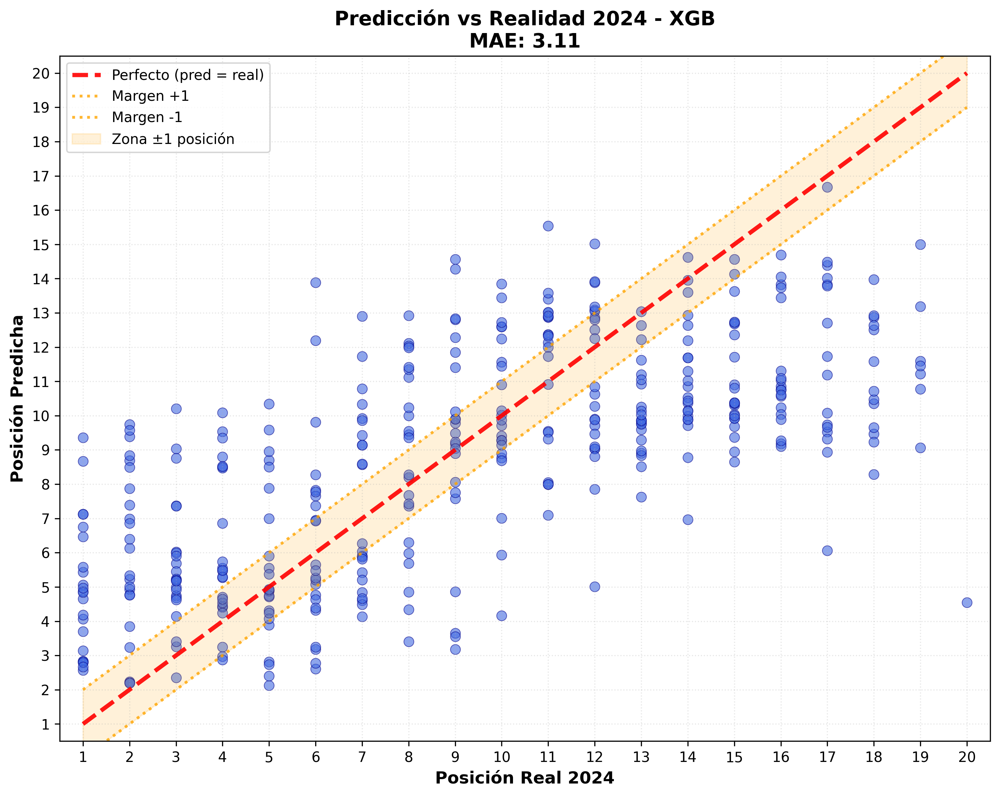
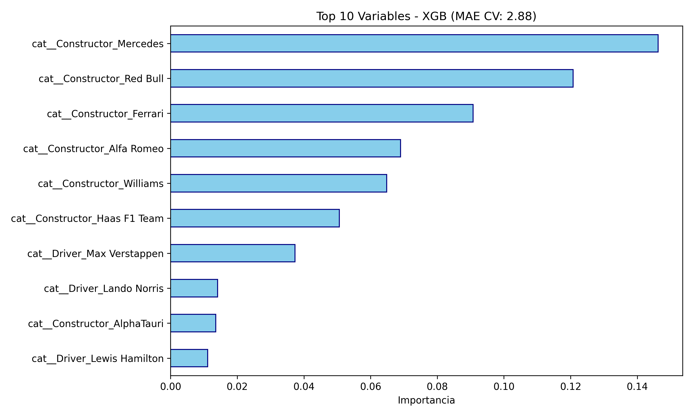
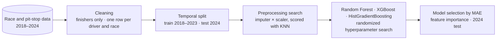

# F1 Finishing Position Model

**A machine-learning model that predicts a driver's finishing position in a Formula 1 race from team, driver, pit-stop and weather data (2018–2024), with a strict season-based validation and an honest baseline comparison.**

Artificial Intelligence in Organizations · BSc in Computer Science and Engineering · Universidad Carlos III de Madrid · December 2025

<p align="center">
  
  
</p>

## The question

Race strategy in F1 depends on many variables: the car, the driver, the pit stops, the tyres and the weather. The project asks how much of a driver's finishing position can be explained by those variables, and which of them matter most.

## The pipeline



- **Cleaning:** drivers who did not finish are filtered out, columns with no predictive use are dropped, and the stint rows are collapsed to one row per driver and race.
- **Validation:** the 2024 season is held out as the test set. All cross-validation is forward-chaining by season: train on every season before *t* and validate on *t*, for *t* = 2020 to 2023.
- **Multicollinearity:** a correlation matrix flags pairs above 0.8 (for example, air and track temperature at 0.996).
- **Models:** Random Forest, XGBoost and HistGradientBoosting, each tuned with a randomized hyperparameter search. The best one by cross-validated MAE is evaluated on 2024.
- **Metrics:** mean absolute error in positions, exact-position accuracy, and accuracy within ±1 position.

## Results

| Version | Selected model | Test MAE (2024) | Exact | Within ±1 |
|---|---|---:|---:|---:|
| Submitted | HistGradientBoosting | 2.91 | 14.2 % | 33.8 % |
| + season-based cross-validation | Random Forest | 3.29 | 7.7 % | 25.9 % |
| + one row per driver and race (**current**) | **XGBoost** | **3.11** | **8.8 %** | **28.2 %** |
| Baseline: constructor's mean position | — | 3.39 | 8.8 % | 25.2 % |

The submitted numbers looked better, but they weren't measuring the same thing:

- **Repeated rows.** The CSV has one row per stint, so each race result appeared two or three times (7,374 rows for 2,821 driver-races). Drivers who stopped more counted more, both in training and in the test metrics.
- **Cross-validation that looked ahead.** The hyperparameter searches used a plain 3-fold split over rows sorted by season, so some folds trained on later seasons and validated on earlier ones.

With both fixed, the model beats a simple baseline (the constructor's average finishing position in 2018–2023) by about 0.3 positions. **The car explains most of the result**: the top features are all constructors, with driver identity next, and the pit-stop and weather variables add little on top.

The fixes were made after the submission, each in its own commit, so the history shows both versions.

## Running it

Requirements: Python 3.10+.

```bash
pip install -r requirements.txt
python code/code.py
```

It takes about a minute. The results are printed to the terminal and the plots are written to `plots/`. The random seed is fixed, so runs are reproducible.

## Tech stack

Python, pandas, NumPy, scikit-learn (pipelines, `ColumnTransformer`, `RandomizedSearchCV`, permutation importance), XGBoost, Matplotlib, seaborn.

## Context

- **Team project** (group of four). The original project also included a written report and a video, which are not in this repository.
- **My contribution:** I worked on the modelling, including the first comparison of five candidate models. The commit history keeps each member's contributions.
- **After the submission:** the requirements cleanup, the season-based validation, the deduplication and the baseline were added in October 2026 with AI assistance (Claude Code). The original submission is the commit "Final version: single script, README and updated plots".
- Code comments and console output are in Spanish.
